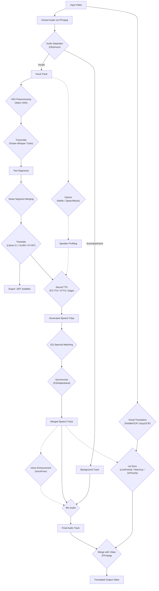

# 🌍 AI Video Translator (Local)

> 🌐 Türkçe sürüm: [README_tr.md](README_tr.md)
>
> **Dil bariyerlerini yıkın — sinema kalitesinde video çevirisi, özel olarak kendi donanımınızda.**

Her videoyu, doğal ses klonlaması, dudak senkronizasyonu ve ekranda metin çevirisiyle profesyonel çok dilli bir üretime dönüştürün. Bulut API'leri yok, abonelik yok, veriniz bilgisayarınızdan ayrılmıyor.

## 📝 Projeden memnun musunuz? Lütfen yıldız verin ⭐️! İlgi seviyesini ölçmeye ve yeni özellikler üzerinde çalışmaya devam etmem için yardımcı oluyor.

---

## 🎬 Demo

[](https://www.youtube.com/watch?v=935PvODrt3I)

> 🎥 **Yukarıdaki görsele tıklayarak YouTube'da tam demosunu izleyebilirsiniz!**

---

## ✨ Bu Proje Neden Önemli?

**Geleneksel dublaj** pahalı, zaman alıcıdır ve profesyonel stüdyolar gerektirir. **AI Video Translator**, Hollywood seviyesindeki teknolojiyi masaüstünüze getirerek video yerelleştirmeyi demokratikleştirir:

- 🎬 **İçerik Yaratıcıları**: Ses sanatçısı tutmadan küresel izleyici kitlesini genişletin
- 🎓 **Eğitimciler**: Eğitim içeriklerini her dilde erişilebilir hale getirin
- 📰 **Gazeteciler & Belgesel Yapımcıları**: Uluslararası izleyiciler için görüntüleri yerelleştirin
- 🎮 **Oyun Geliştiricileri**: Kesit sahneleri ve fragmanları uygun maliyetle dublajlayın
- 🏢 **İşletmeler**: Kurumsal videoları, sunumları ve web seminerlerini çevirin
- 🔒 **Gizlilik Odaklı Kullanıcılar**: Hassas içerikleri %100 yerelde tutun

---

## 🎯 Ne Yapıyor?

Bir video yükleyin, hedef dili seçin ve AI her şeyi halletsin:

```
📹 Giriş Videosu (İngilizce) → 🤖 AI Pipeline → 📹 Çıktı Videosu (Fransızca, klonlanmış ses & senkronize dudaklar)
```

**Tam pipeline şunları içerir:**
1. **Vokal Ayrımı** — Müzik/ses efektlerinden konuşmayı ayırır
2. **Transkripsiyon** — Konuşmayı kelime seviyesinde metne dönüştürür
3. **Çeviri** — Metni yerel LLM'ler veya Google Translate ile çevirir
4. **Ses Klonlama** — Hedef dilde konuşmayı orijinal konuşmacının sesine benzer şekilde yeniden üretir
5. **Dudak Senkronizasyonu** — Ağız hareketlerini yeni sesle eşleştirir
6. **Görsel Metin Çevirisi** — Ekrandaki metni (altyazılar, tabelalar vb.) tespit edip değiştirir
7. **Ses Geliştirme** — Üretilen konuşmayı yayın kalitesine uygun şekilde temizler ve iyileştirir

---

## 🚀 Temel Özellikler

### Ses Zekası
| Özellik | Teknoloji | Açıklama |
|---------|------------|-------------|
| **Vokal Ayrımı** | HDemucs (Meta) | Arka plan müziği / ses efektlerinden konuşmayı temiz şekilde ayırır; uzun videolar için GPU parçalama kullanır |
| **Transkripsiyon** | Faster-Whisper (Large v3 Turbo) | Silero VAD ön işleme ve kelime düzeyinde güven filtresiyle %30-50 daha hızlı |
| **Konuşmacı Diyarizasyonu** | NeMo MSDD / SpeechBrain | Çok sesli dublaj için bireysel konuşmacıları tanımlar |
| **EQ Spektral Eşleme** | Özel | TTS çıktısına orijinal sesin ton özelliklerini uygular |
| **Ses Geliştirme** | VoiceFixer | Bozulmuş konuşmayı iyileştirir ve gürültüyü kaldırır (isteğe bağlı) |

### Çeviri Motoru
| Model | Tür | En Uygun Durum |
|-------|------|----------|
| **Google Translate** | Çevrimiçi | Hızlı, güvenilir günlük çeviri |
| **Tencent HY-MT1.5** | Yerel (1.8B) | Daha iyi bağlam korunumu |
| **Llama 3.1 8B Instruct** | Yerel | Daha nüanslı, insan gibi çeviriler |
| **ALMA-R 7B** | Yerel | En iyi çeviri kalitesi |

Tüm yerel modeller **bağlam farkındalığı modu** kullanır; tam transkript bağlamıyla daha iyi tutarlılık sunar.

### Ses Sentezi (TTS)
| Model | Tür | Öne Çıkanlar |
|-------|------|------------|
| **Edge-TTS** | Çevrimiçi | Doğal Microsoft sesleri, GPU gerekmez |
| **Piper TTS** | Yerel | Sağlam çevrimdışı sinirsel TTS (otomatik indirilir) |
| **XTTS-v2** | Yerel | Duygu kontrolüyle yüksek kaliteli ses klonlama (Mutlu, Üzgün, Kızgın) |
| **F5-TTS** | Yerel | Ultra hızlı sıfır-örnek ses klonlama (Sway Sampling) |
| **VibeVoice** | Yerel | Microsoft'un öncü uzun-form çok konuşmacılı TTS (1.5B/7B) |

### Görsel Geliştirmeler
| Özellik | Teknoloji | Açıklama |
|---------|------------|-------------|
| **Dudak Senkronizasyonu (Hızlı)** | Wav2Lip-GAN | Pürüzsüz, harmanlanmış dudak senkronizasyonu |
| **Dudak Senkronizasyonu (HD)** | Wav2Lip + GFPGAN | Yüz restorasyonu bulanıklığı ortadan kaldırır |
| **Dudak Senkronizasyonu (Cinema)** | LivePortrait | Doğal hareketli sinematik dudak senkronizasyonu |
| **Görsel Metin Çevirisi** | PaddleOCR / EasyOCR | OpenCV inpainting ile ekrandaki metni tespit edip değiştirir |

## 🌐 Desteklenen Diller

Video Translator, hem kaynak hem hedef çeviri için geniş bir dil yelpazesini destekler.

| Dil | Kod |
|:---|:---:|
| **Otomatik Tespit** | `auto` |
| **İngilizce** | `en` |
| **İspanyolca** | `es` |
| **Fransızca** | `fr` |
| **Almanca** | `de` |
| **İtalyanca** | `it` |
| **Portekizce** | `pt` |
| **Lehçe** | `pl` |
| **Türkçe** | `tr` |
| **Rusça** | `ru` |
| **Hollandaca** | `nl` |
| **Çekçe** | `cs` |
| **Arapça** | `ar` |
| **Çince (Basitleştirilmiş)** | `zh` |
| **Japonca** | `ja` |
| **Korece** | `ko` |
| **Hintçe** | `hi` |

### Üretim Hazır
- 🖥️ **Kullanıcı Dostu Gradio Arayüzü** — Kolay sürükle-bırak arayüzü
- 🎛️ **Detaylı Kontrol** — Beam boyutu, VAD ayarları, ses seçimi ve daha fazlası
- 👤 **LivePortrait Dudak Senkronizasyonu** — TensorRT hızlandırma desteğiyle son teknoloji dudak senkronizasyonu
- 🖼️ **Görsel Metin Çevirisi** — Video karelerinde metni tespit eder, çevirir ve sorunsuz şekilde değiştirir (hız için önbelleğe alınır)
- 📝 **Otomatik Üretilen Altyazılar** — Çevrilmiş videolarla birlikte `.srt` dosyaları dışa aktarır
- 🔄 **Akıllı Segment Birleştirme** — Kırık cümleleri doğal cümlelere birleştirir
- ⏳ **Gerçek Zamanlı İlerleme & ETA** — Ayrıntılı ilerleme ve kalan süreyi takip eder
- 🧹 **VoiceFixer Geliştirmesi** — Ses kalitesini iyileştirir ve stüdyo kalitesine getirir
- ⚡ **GPU Optimize Edilmiş** — Maksimum VRAM verimliliği için tek model aynı anda politikası
- 🛡️ **Global CPU Yedekleme** — GPU başarısız olursa otomatik olarak CPU'ya geçer

---

## 🎬 Kullanım Alanları

### 🎥 YouTube & Sosyal Medya Yaratıcıları
> "50 İngilizce eğitmen videom var ve İspanyolca konuşanlara ulaşmak istiyorum."

Her videoyu yükleyin, İngilizce → İspanyolca seçin ve klonlanmış sesinizle profesyonel dublajları dışa aktarın. Yeniden kaydetmeye gerek yok!

### 🎓 Kurumsal Eğitim & E-Öğrenme
> "Uyumluluk eğitimimiz İngilizce ama ofislerimiz 12 ülkede."

Sunucunun sesini koruyarak eğitim videolarını çok dilli çevirin. Altyazılarla veya altyazısız dışa aktarın.

### 🎞️ Film & Belgesel Yerelleştirme
> "Kendi bağımsız filmim uluslararası festivallerde premier yapmak istiyor."

Kötü bir overdub gibi görünmeyen sinema kalitesinde dublaj için LivePortrait (HD) dudak senkronizasyonunu kullanın.

[LivePortrait GPU Hızlandırma](LivePortrait%20GPU%20Acceleration.md)

### 📢 Pazarlama & Reklamcılık
> "30 saniyelik reklamımızı yarın Fransızca, Almanca ve Japonca'ya çevirmemiz gerekiyor."

Markaya uygun mesajlaşma için yerel LLM çevirisiyle birden fazla dil sürümünü aynı anda işleyin.

### 🔐 Hassas İçerik Çevirisi
> "Videomuz gizli ürün demo içeriyor."

Her şey yerelde çalışır — veriniz bilgisayarınızdan ayrılmaz. Hukuk ekibi, tıbbi içerik veya özel bilgi için mükemmeldir.

---

## 🛠️ Ön Koşullar

| Gereksinim | Ayrıntılar |
|-------------|---------|
| **Python** | 3.10+ (3.10 önerilir) |
| **PyTorch** | CUDA 12.4+ ile 2.5.1+ |
| **GPU** | NVIDIA GPU önerilir (RTX 30/40/50 serisi desteklenir) |
| **VRAM** | Minimum 8GB, HD dudak senkronizasyonu için 12GB+ önerilir |
| **FFmpeg** | Sistem PATH içinde olmalıdır |
| **Rubberband** | Yüksek kaliteli ses time-stretch için önerilir |

<details>
<summary><strong>📥 FFmpeg Kurulumu</strong></summary>

**Windows (Seçenek 1):**
```powershell
winget install ffmpeg
# Kurulumdan sonra terminali yeniden başlatın
```

**Windows (Seçenek 2 - Manuel):**
1. [ffmpeg.org/download](https://ffmpeg.org/download.html) adresinden indirin (Windows build'leri → gyan.dev)
2. `C:\ffmpeg` klasörüne çıkarın
3. `C:\ffmpeg\bin` yolunu sistem PATH'ine ekleyin
4. Terminali yeniden başlatın ve doğrulayın: `ffmpeg -version`

**Linux:**
```bash
sudo apt install ffmpeg
```

**macOS:**
```bash
brew install ffmpeg
```
</details>

<details>
<summary><strong>📥 Rubberband Kurulumu</strong></summary>

[Rubberband Releases](https://breakfastquay.com/rubberband/) adresinden indirin. Çıkarıp PATH'e ekleyin veya `rubberband-program.exe` dosyasını proje klasörüne yerleştirin.
</details>

---

## 📦 Kurulum

### 🚀 Hızlı Kurulum (Önerilen)

Akıllı kurucu platformu, GPU'yu ve CUDA sürümünü otomatik algılar:

```bash
# Depoyu klonlayın
git clone https://github.com/overcrash66/video-translator.git
cd video-translator

# Windows:
scripts\install.bat

# Linux / macOS:
chmod +x scripts/install.sh
./scripts/install.sh
```

### 🔧 Manuel Kurulum

<details>
<summary><strong>Windows (CUDA 12.8 — RTX 30/40/50 serisi)</strong></summary>

```powershell
py -3.10 -m venv venv
.\venv\Scripts\activate
pip install -r requirements.txt
```
</details>

<details>
<summary><strong>Linux (CUDA 12.4)</strong></summary>

```bash
python3.10 -m venv venv
source venv/bin/activate
pip install torch torchvision torchaudio --index-url https://download.pytorch.org/whl/cu124
pip install -r deploy/docker/requirements.docker.txt
```
</details>

<details>
<summary><strong>macOS (Apple Silicon — Sadece CPU)</strong></summary>

```bash
python3.10 -m venv venv
source venv/bin/activate
pip install torch torchvision torchaudio
pip install -r requirements.txt
```

> [!NOTE]
> Bazı GPU hızlandırmalı özellikler Apple Silicon üzerinde daha düşük performans gösterebilir. Platforma özel
> paket değişimi (`paddlepaddle` yerine `paddlepaddle-gpu`, `onnxruntime` yerine `onnxruntime-gpu`)
> otomatik olarak gereksinim dosyalarındaki platform işaretleri tarafından yönetilir.
</details>

<details>
<summary><strong>Gelişmiş: pyproject.toml extras kullanımı</strong></summary>

```bash
# CUDA 12.4 ile tam kurulum (varsayılan):
pip install -e ".[all]"

# Tam kurulum CUDA 12.8 (RTX 50 serisi):
pip install -e ".[all-cu128]" --extra-index-url https://download.pytorch.org/whl/cu128

# Sadece CPU:
pip install -e ".[all-cpu]"

# En az (yalnızca çekirdek + geliştirme araçları):
pip install -e ".[dev]"

# Seçmeli kurulum (gerek duyduğunuzu seçin):
pip install -e ".[tts,ocr,lipsync]"
```
</details>

### ✅ Kurulum Doğrulama

```bash
# Kurulumunuzu doğrulamak için smoke testlerini çalıştırın
pytest tests/test_smoke_install.py -m smoke -v

# Veya kurucunun doğrulama modunu kullanın
python scripts/install.py --verify
```

### İsteğe Bağlı Bileşenler

| Özellik | Gereksinim |
|---------|-------------|
| **NeMo Diyarizasyon** | `nemo_toolkit[asr]` |
| **Wav2Lip** | `models/wav2lip/wav2lip_gan.pth` model dosyası |
| **F5-TTS** | `f5-tts` paketi (GPU önerilir) |
| **Gelişmiş Dudak Senkronizasyonu** | `gfpgan` ve `basicsr` (requirements içinde yer alır) |
| **LivePortrait** | ~2GB VRAM, `models/live_portrait` klasörüne otomatik indirilir |
| **Llama 3.1 / NeMo** | HuggingFace token (`HF_TOKEN` ortam değişkeni) |
| **VoiceFixer** | `pip install voicefixer>=0.1.2` (gerekirse pip < 24.1 kullanılabilir) |

### 🐳 Docker Dağıtımı (GPU)

Uygulamayı NVIDIA GPU desteğiyle bir Docker konteynerinde çalıştırabilirsiniz.

**Önkoşullar:**
- **NVIDIA Sürücüsü** (CUDA 12.x uyumlu)
- **Docker Desktop** (Windows) veya Docker Engine (Linux)
- **NVIDIA Container Toolkit** (Docker içinde GPU erişimi için)

#### Build ve Çalıştırma (Önerilen)

1. **İmajı oluşturun** (proje kökünden çalıştırın):
    ```bash
    docker build -f deploy/docker/Dockerfile -t video-translator .
    ```

3. **Konteyneri çalıştırın**:
    ```bash
    # PowerShell için:
    docker run --gpus all -p 7860:7860 -v ${PWD}/output:/app/output --name video-translator video-translator

    # Command Prompt (CMD) için:
    docker run --gpus all -p 7860:7860 -v %cd%/output:/app/output --name video-translator video-translator
    ```

    > **Not:** "Ports are not available" hatasıyla karşılaşırsanız (Windows'ta Hyper-V ile yaygındır), farklı bir ana bilgisayar portu kullanmayı deneyin, örn. **7950**:
    > ```bash
    > docker run --gpus all -p 7950:7860 -v ${PWD}/output:/app/output --name video-translator video-translator
    > ```

4. **Uygulamaya Erişim**:
    Tarayıcınızda `http://localhost:7860` adresini açın (veya alternatif port kullandıysanız `http://localhost:7950`).

#### 🔧 Sorun Giderme

**"Ports are not available" / "Access is denied"**
Windows'ta Hyper-V veya WinNAT bazen büyük port aralıklarını rezerve eder (7860 dahil).
- **Çözüm:** Yukarıdaki örnekte olduğu gibi farklı bir host portu kullanın (7950 veya 8080 gibi).
- **Rezerve edilmiş aralıkları kontrol edin:** `netsh interface ipv4 show excludedportrange protocol=tcp` komutunu çalıştırıp hangi portların engellendiğini görün.

---

## 🖥️ Kullanım

### Hızlı Başlangıç

```bash
# Ortamı etkinleştirin
.\venv\Scripts\activate

# Uygulamayı başlatın
python app.py
```

Tarayıcınızda `http://127.0.0.1:7860` adresini açın.

### Adım Adım Çeviri

1. **Video Yükleyin** — MP4, MKV veya MOV dosyaları sürükleyip bırakın
2. **Dilleri Seçin** — Kaynak (veya Otomatik Tespit) → Hedef
3. **Modelleri Seçin:**
   - **Çeviri**: Google (hızlı) / Llama 3.1 (kalite) / ALMA-R (en iyi)
   - **TTS**: Edge (çevrimiçi) / F5-TTS (hızlı klonlama) / XTTS (duygu kontrolü)
4. **Özellikleri Etkinleştirin** (isteğe bağlı):
   - ✅ Konuşmacı Diyarizasyonu — Çok konuşmacılı videolar
   - ✅ Dudak Senkronizasyonu — Kalite seviyesi seçin (Hızlı/HD/Cinema)
   - ✅ Görsel Metin Çevirisi — Ekrandaki metni değiştirin
   - ✅ Ses Geliştirme — VoiceFixer sonrası işleme
5. **"Process Video"** butonuna tıklayın ve ilerlemeyi izleyin

---

## ⚙️ Yapılandırma

### Dizin Yapısı
```
video-translator/
├── temp/           # Ara dosyalar (otomatik temizlenir)
├── output/         # Son çevrilmiş videolar
├── models/         # İndirilen model ağırlıkları
└── .env            # Ortam değişkenleri (HF_TOKEN, vb.)
```

### Ortam Değişkenleri
```env
HF_TOKEN=your_huggingface_token  # Gerekli: Llama 3.1, NeMo
```

---

## 🧩 Pipeline Mimarisi



---

## 🤝 Katkıda Bulunma

Katkılar memnuniyetle karşılanır. Yardıma ihtiyaç duyulan alanlar:
- Ek dil desteği ve ses modelleri
- Performans optimizasyonları
- Hata düzeltmeleri ve kararlılık iyileştirmeleri
- Dokümantasyon ve eğitimler

---

## 🏷️ Atıf

Projeden faydalandıysanız, lütfen aşağıdaki şekilde atıf yapın:

```bibtex
@software{video_translator,
  author = {Wael Sahli},
  email = {leawwael6@gmail.com},
  title = {AI Video Translator},
  url = {https://github.com/overcrash66/video-translator},
  version = {1.0.0},
  date = {2026-06-15}
}
```

---

## 📄 Lisans

Bu proje eğitim ve kişisel kullanım içindir. Altta yatan modellerin ve teknolojilerin lisanslarına saygı gösterin.

---

<div align="center">

**🌟 Bu depoyu faydalı bulursanız yıldız verin! 🌟**

*Dünya çapında içerik yaratıcıları için ❤️ ile yapıldı*

</div>
